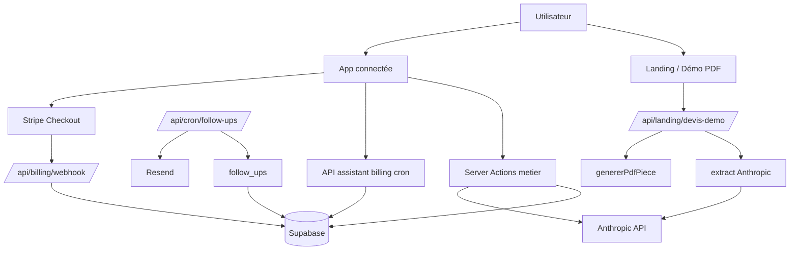
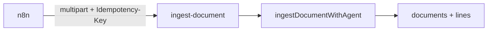
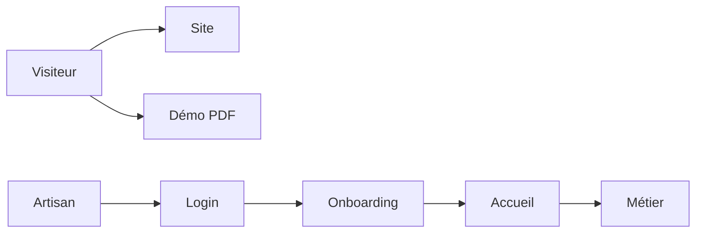
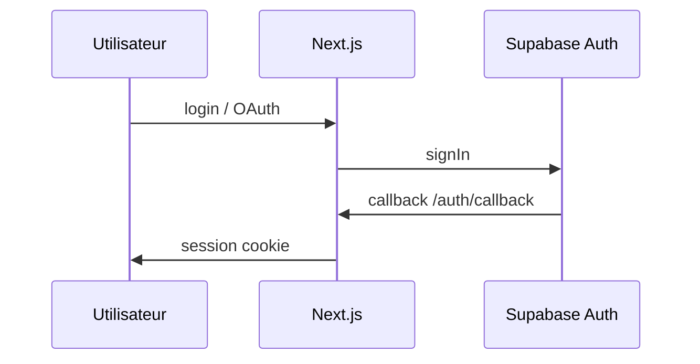
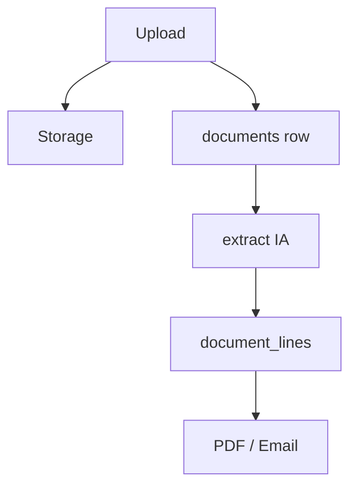
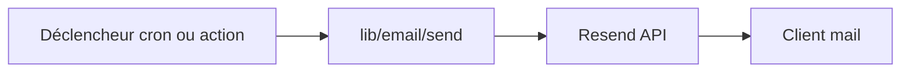
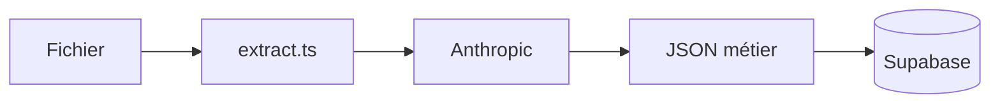
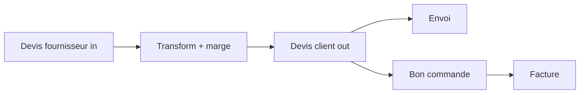

# TARINEO — Mission Control (manuel Noam)

> **Légende statuts** (utilisée partout dans ce doc)  
> 🟢 Fonctionne réellement (code branché + chemin clair)  
> 🟡 Présent dans le code — à valider en prod / avec ta config  
> 🟠 Partiellement implémenté  
> 🔴 Pas encore fait  
> ⚪ Démo, mock ou UI seulement  

**Dernière cartographie :** octobre 2026 — basée sur le repo `navpit` (produit TARINEO).

---

## Sommaire rapide

1. [TARINEO en 5 minutes](#tarineo-en-5-minutes)
2. [TARINEO en 60 secondes](#tarineo-en-60-secondes)
3. [Parcours utilisateur réel](#parcours-utilisateur-réel)
4. [Carte du système](#carte-du-système)
5. [Dossiers importants](#dossiers-importants)
6. [Moteur d'automatisation](#moteur-dautomatisation)
7. [Exemple : relance devis](#exemple-relance-devis)
8. [Ce que TARINEO peut automatiser](#ce-que-tarino-peut-automatiser-aujourdhui)
9. [Emails](#emails)
10. [Intégrations](#intégrations)
11. [Google / OAuth](#google--oauth)
12. [Supabase](#supabase)
13. [IA](#ia)
14. [Démo landing PDF](#démo-landing-pdf)
15. [Sécurité](#sécurité)
16. [Argent (Stripe)](#argent-stripe)
17. [Roadmap automatisation](#roadmap-automatisation)
18. [Cursor = Mission Control ?](#cursor--mission-control)
19. [Chapitres « Si ça casse »](#chapitres-si-ça-casse)
20. [Diagrammes de flux](#diagrammes-de-flux)
21. [Verdict final](#verdict-final)

---

# TARINEO en 5 minutes

**À retenir**

1. TARINEO aide les **artisans BTP** à gérer devis, factures et paperasse.
2. Le cœur = **documents** (PDF/photos) → **extraction IA** → **devis client** avec marge.
3. Les données vivent dans **Supabase** (un compte = un `user_id`).
4. Les **emails produit** partent via **Resend** (pas Gmail en envoi).
5. L’**abonnement** passe par **Stripe** (TARINEO vend TARINEO, pas les paiements des clients de l’artisan).

| Question | Réponse simple |
|----------|----------------|
| **À quoi ça sert ?** | Transformer des docs fournisseurs en docs clients, suivre chantiers, relancer, alertes prix. |
| **Pour qui ?** | Artisans, petites équipes BTP en France. |
| **Quel problème ?** | Moins de ressaisie, moins d’oublis de relance, marge visible. |
| **Workflow principal** | Déposer doc → lire → structurer → devis/facture → envoyer → relancer si besoin. |
| **Où l’IA ?** | Lecture PDF/images (Anthropic), copilote chat, brouillons mail, schémas. |
| **Automatisations ?** | Relances devis (cron), alerte marge basse (à la transformation), exports compta planifiés (cron). |
| **Supabase ?** | Auth, BDD, fichiers privés, RLS par utilisateur. |
| **Resend ?** | Tous les mails sortants « produit » (relances, auth, billing…). |
| **Stripe ?** | Abonnement TARINEO (plans free / pro / founder…). |
| **Intégrations ?** | Hub UI ; Google/iCal/API keys partiellement réels ; ERP = waitlist. |

### Si tu ne devais retenir que 10 choses

1. Un **devis** en base = une ligne `documents` avec `kind = devis`, pas une table « devis ».
2. **Connexion obligatoire** pour l’app métier ; la **landing** et la **démo PDF** sont publiques.
3. **Resend** envoie les mails ; **Google connecté** ≠ envoi Gmail automatique aujourd’hui.
4. **Relances** = table `follow_ups` + cron quotidien + réglages `/automatisations`.
5. **Marge** : réglages entreprise + slider ; automatisation « marge sous seuil » = notification in-app.
6. **Extraction** = Anthropic ; sans crédits API, l’analyse échoue (problème billing, pas toujours code).
7. **RLS** : chaque utilisateur ne voit que ses lignes (`user_id = auth.uid()`).
8. **Deux mondes** dans le repo : **TARINEO métier** + vestiges **Navpit** (projets, schémas…).
9. La **démo landing** = 1 PDF gratuit / appareil, extraction réelle, pas de compte requis.
10. Beaucoup de pages **catalogue / démo** (`/client`, `/distributeur`) = vitrines, pas le flux principal.

---

# TARINEO en 60 secondes

TARINEO est une app Next.js pour artisans : tu déposes un PDF fournisseur, l’IA lit les lignes, tu appliques une marge, tu génères un devis client. Tout est stocké chez Supabase sous ton compte. Les relances partent par email (Resend). Tu paies TARINEO via Stripe. Sur tarineo.com, les visiteurs peuvent essayer **une** transformation PDF sans s’inscrire. Le reste de l’app demande login + onboarding.

---

# Parcours utilisateur réel

Schéma **corrigé** par le code (pas le marketing idéal) :

```
VISITEUR
   ↓
LANDING (/) — public
   ↓ option A : démo PDF (#devis-facture) — sans compte
   ↓ option B : inscription /login
INSCRIPTION → Supabase Auth (email ou Google login)
   ↓
/auth/callback — pose la session
   ↓
ONBOARDING (/onboarding) — 🟡 à valider selon profil rempli
   ↓
ACCUEIL (/accueil) — dashboard artisan
   ↓
ANALYSE IA (/devis/analyser) — import document
   ↓
DOCUMENT en base (documents + document_lines + fichier Storage)
   ↓
TRANSFORMATION — devis fournisseur → devis client (marge)
   ↓
ENVOI — email PDF (Resend) ou téléchargement
   ↓
RELANCES (/relances) + CRON — si pas de réponse
   ↓
FACTURE / BON DE COMMANDE — documents liés (source_document_id)
   ↓
AUTOMATISATIONS (/automatisations) — relances auto, marge, connexions
```

**Ce qui n’est PAS le chemin principal**

- `/projets`, `/schemas`, `/assistant` (Navpit / studio) — 🟠 secondaire pour TARINEO artisan.
- `/client`, `/distributeur` — ⚪ pages vitrine / démo composants.
- `/copilote` — 🟢 chat IA connecté au métier, mais pas obligatoire pour le flux document.

---

# Carte du système

### Vue ASCII

```
[ Visiteur / Artisan ]
         │
         ▼
   Next.js 15 (App Router)
   ├── (site) landing, prix, légal
   ├── (auth) login, inscription
   ├── (app) métier protégé middleware
   └── API routes (cron, billing, landing, assistant…)
         │
    ┌────┴────┬──────────┬─────────┐
    ▼         ▼          ▼         ▼
 Supabase   Anthropic  Resend   Stripe
 Auth+DB    (IA)       (email)  (abonnement)
 Storage
```

### Mermaid



---

# Dossiers importants

Format court pour chaque zone.

### `app/`

| | |
|---|---|
| **Rôle** | Pages et routes HTTP Next.js |
| **Important** | `(site)/` landing · `(auth)/` login · `(app)/` produit · `(onboard)/` · `api/` |
| **Dépend de** | `lib/`, middleware Supabase |
| **Risque** | Oublier `PUBLIC_PATHS` dans middleware = API landing bloquée |
| **Exemple** | `/devis/analyser` importe un PDF → `metier/actions.ts` |

### `components/`

| | |
|---|---|
| **Rôle** | UI React (shell, métier, landing-v2, settings…) |
| **Important** | `components/metier/` · `components/site/landing-v2/` · `components/tarineo/` |
| **Dépend de** | `lib/`, hooks |
| **Exemple** | `document-drop.tsx` → upload |

### `lib/`

| | |
|---|---|
| **Rôle** | Logique métier, intégrations, PDF, automation, billing |
| **Important** | `lib/metier/` · `lib/automation/` · `lib/email/` · `lib/billing/` · `lib/site/` (landing) |
| **Risque** | Fichiers `server-only` ne doivent pas être importés côté client |
| **Exemple** | `extract.ts` + `document-agent/` = lecture IA |

### `supabase/migrations/`

| | |
|---|---|
| **Rôle** | Schéma SQL, RLS, fonctions trial |
| **Important** | `metier_graph`, `follow_ups`, `automation_engine`, `accounting_exports` |
| **Risque** | `types.ts` pas toujours à jour (tables automation manquantes) |

### `public/`, `styles/`

Assets, polices, images landing.

### `scripts/`

Seeds, emails test, Stripe setup, Remotion — pas le runtime prod.

### `docs/`

Audits, ADR automation, intégrations — **ce fichier** = carte produit pour toi.

---

# Moteur d'automatisation

**À retenir**

- Deux tables : `automation_definitions` (règles) et `automation_executions` (journal idempotent).
- Les **relances** existaient avant ; l’engine ajoute planification auto + traçabilité.
- **Pas** de moteur central unique (`engine.ts`) — handlers séparés.
- Cron **07:15 UTC** : `/api/cron/follow-ups`.

### Tables

| Table | Rôle |
|-------|------|
| `automation_definitions` | Par user + slug : `quote_followup`, `margin_below_target` — `enabled`, `config` JSON |
| `automation_executions` | Une ligne par tentative idempotente (schedule / send / notify) |
| `follow_ups` | Relance concrète (email, date, statut, séquence) |

### Slugs implémentés

| Slug | Déclencheur | 🟢/🟡 |
|------|-------------|-------|
| `quote_followup` | Cron phase A + B | 🟢 si cron + Resend + définition activée |
| `margin_below_target` | Transformation devis import → client | 🟢 notification in-app ; email config 🟠 non branché |

### Chemin réel relance devis

```
DEVIS client envoyé (extract.sent_at renseigné)
        ↓
[Phase A — autoScheduleDueQuoteFollowUps]
  automation_definitions (enabled + autoScheduleEnabled)
  → éligibilité document (pas déjà transformé, email client…)
  → INSERT follow_ups status=scheduled + execution idempotency
        ↓
[Attente scheduled_at]
        ↓
[Phase B — processScheduledFollowUps]
  → claim attempt_number
  → préférence user emailFollowups
  → Resend sendEmailWithPdf (clé idempotency quote_followup:send:…)
  → follow_ups status=sent
  → automation_executions completed (ou failed)
```

**Important :** l’UI `/relances` montre aussi des lignes **virtuelles** « à relancer » (délai fixe 3 jours) qui ne sont **pas** la même chose que `firstDelayDays` de l’automation — 🟠 double logique à connaître.

### Idempotence (anti-doublon)

| Étape | Clé type |
|-------|----------|
| Planifier séquence | `quote_followup:schedule:{docId}:{seq}` |
| Envoyer email | `quote_followup:send:{docId}:{seq}` |
| Marge basse | `margin_below:document:{id}:{floor}:{jour}` |
| Index SQL | une séquence active par document |

### Fichiers clés

- `lib/automation/handlers/quote-followup.ts`
- `lib/metier/follow-up-queries.ts`
- `app/api/cron/follow-ups/route.ts`
- `app/(app)/automatisations/` + `actions.ts`

---

# Exemple : relance devis

**Scénario :** artisan envoie un devis à `client@example.com`.

| Jour | Événement | Système |
|------|-----------|---------|
| J0 | Devis marqué envoyé (`sent_at`) | Document prêt pour relance |
| J+X | Pas de facture / BC créé | Phase A peut créer `follow_ups` séquence 1 |
| J+X+h | `scheduled_at` passé | Cron B envoie email Resend |
| — | Client répond hors app | Artisan marque **answered** ou **done** manuellement 🟡 |
| — | Client accepte → BC/facture | `isDocumentTransformed` → plus de relance auto |
| — | Client refuse | **done** / **cancelled** → `followUpStillEligible` = non |

### Statuts `follow_ups`

| Statut | Signification |
|--------|----------------|
| `due` | Affichage « à relancer » (souvent virtuel) |
| `scheduled` | Email programmé |
| `sent` | Email parti |
| `answered` | Réponse reçue (clôture partielle) |
| `done` | Terminé |
| `cancelled` | Annulé |

**Séquences :** config `maxSequences` (souvent 2), délai `betweenSequencesDays` entre séquence 1 et 2.

---

# Ce que TARINEO peut automatiser aujourd'hui

| Capacité | Statut | Notes |
|----------|--------|-------|
| Relances devis (email) | 🟢 | Cron + Resend ; réglages `/automatisations` |
| Planification auto relances | 🟡 | `autoScheduleEnabled` false par défaut |
| Alerte marge sous seuil | 🟢 in-app | À la transformation devis ; pas email auto |
| Export compta CSV planifié | 🟢 | Cron séparé `accounting-exports` |
| Notifications in-app | 🟢 | `notifications` |
| Emails auth / billing | 🟢 | Resend |
| Relance facture dédiée | 🔴 | Pas de slug séparé |
| Gmail comme expéditeur | 🔴 | Scope OAuth oui, envoi non |
| ERP PennyLane / Sage… | ⚪ waitlist | |
| Hausses prix fournisseur | 🟡 | `price_alerts` + page `/hausses` — pas cron email générique |
| Onboarding auto emails | 🟡 | Welcome Resend partiel |
| Google Calendar sync | 🟠 | iCal feed lecture sur `/accueil` |
| Historique `automation_executions` UI | 🔴 | Écrit en base, pas de page historique |
| Moteur cron unifié `/api/cron/automations` | 🔴 | ADR prévu, pas codé |

---

# Emails

**À retenir**

- **Resend** = seul envoi réel du produit.
- **Google** = connexion + test profil ; **ne remplace pas** Resend pour les relances.
- Idempotence Resend + lignes `automation_executions` pour les relances.

| Question | Réponse |
|----------|---------|
| Qui envoie ? | `lib/email/send.ts` → API Resend |
| Quand ? | Relance cron, envoi manuel document, auth, billing, export compta |
| Depuis quelle adresse ? | `EMAIL_FROM` / domaine vérifié Resend |
| Reply-To ? | Souvent l’email de l’artisan |
| Doublons ? | Clés idempotency par document + séquence |
| Si Resend échoue ? | `automation_executions` failed ; relance possible heure suivante (clé failed datée) |
| Séquence | `sequence_number` 1 puis 2 si config le permet |

**GOOGLE ≠ moteur des relances** — confirmé dans le code.

---

# Intégrations

## TARINEO ↔ n8n (Phase 6)

🟢 **Import document API** : `POST /api/integrations/ingest-document`  
🟢 **MCP métier** : `tarineo_ingest_document`, `tarineo_list_documents`, `tarineo_get_document`  
🟡 **Gmail dans n8n** : à configurer dans n8n (TARINEO ne lit pas la boîte mail)  
🔴 **Webhooks sortants** TARINEO → n8n  



Contrat : `docs/TARINEO-N8N-CONTRACT.md` — Pro + scope `write` + entitlement `mcp_business`.

**Gmail automatique :** TARINEO ne lit pas la boîte mail. Workflow n8n documenté dans `docs/TARINEO-N8N-GMAIL-WORKFLOW.md` (Gmail Trigger → PJ → ingest API). OAuth Google dans l’app = envoi / liaison, pas import PJ.

---

Hub : `/automatisations#connexions` (redirect depuis `/parametres/integrations`).

| Intégration | Connectable | Fonctionnelle | Backend | Automation | Statut |
|-------------|-------------|---------------|---------|------------|--------|
| **tarineo_email** (Resend) | Non (env plateforme) | 🟡 | Test domaines Resend | Tous mails | requires_setup si pas de clé |
| **stripe_billing** | Via /abonnement | 🟢 | Stripe + table subscriptions | Non | Abonnement TARINEO |
| **google** (Gmail) | OAuth | 🟠 | Profil Gmail testé | Non envoi | reconnection_required si token mort |
| **calendar_ical** | URL iCal | 🟢 | Fetch flux | Non | Accueil |
| **api_tarineo** | Clés compte | 🟢 | `/api/mcp` + `POST /api/integrations/ingest-document` | Ingest n8n (Pro) | Agents / n8n |
| **microsoft** | Non | 🔴 | — | — | coming_soon |
| **pennylane, sage, ebp…** | Waitlist | 🔴 | — | — | UI |
| **cedeo, pointp, rexel, sonepar** | Import PDF | 🟢 | Extraction métier | Non | manual_import |
| **Google Drive** | OAuth /outils | 🟠 | Bind tool_connections | Non | Pas d’API Drive dans le code |

Fichiers : `lib/integrations/`, `lib/settings/integrations-catalog.ts`.

---

# Google / OAuth

### Parcours connexion intégration Gmail

```
Utilisateur clique Connecter Google
   → GET /api/connect/google?tools=gmail
   → Supabase signInWithOAuth (scopes gmail.send…)
   → /auth/callback?next=…
   → /automatisations?bound=gmail
   → completeGoogleBindAction → tool_connections
```

**Login Google** (page connexion) = flux séparé, **sans** bind relances.

### `reconnection_required`

Signifie : le test de santé Google a échoué (token expiré, scope retiré, compte changé). L’UI propose **Reconnecter**. Statut dans `integrations-store` + `providers/google.ts`.

---

# Supabase

**À retenir**

- Un artisan = un `auth.users` + plein de lignes `user_id`.
- **RLS** : presque tout filtré par `auth.uid()`.
- **Devis** = `documents` où `kind = 'devis'`.

### Chaîne métier (simplifié)

```
USER (auth.users)
  → company_profiles (entreprise, settings, marge)
  → parties (clients, fournisseurs…)
  → chantiers (optionnel party client)
  → documents (devis, facture, BC…)
  → document_lines
  → follow_ups (relances)
  → storage bucket documents/{user_id}/…
```

### Auth & billing

- `subscriptions` : miroir Stripe (lecture seule user).
- Trial Pro : `start_pro_trial()` — expiration peut **supprimer** le user (`enforce_pro_trial_expiry`).

---

# IA

| Usage | Fichier / route | Entrée | Sortie |
|-------|-----------------|--------|--------|
| Extraction PDF/image | `lib/metier/extract.ts` | base64 + mime | JSON `ExtractResult` |
| Agent fournisseur | `document-agent/extract-with-agent.ts` | + profils vendeurs | + recap qualité |
| Landing démo | `landing-quote-extract.server.ts` | fichier anonyme | payload landing |
| Copilote | `/api/assistant` | chat + fichiers | texte + tools |
| Brouillon mail | `draft-mail.ts` | contexte doc | texte |
| Schémas | `/api/schemas/generate` | prompt | schéma |

**Modèle par défaut :** `claude-sonnet-5` (`ANTHROPIC_MODEL` / `lib/models.ts`).

### Flux document (compte connecté)

```
UPLOAD → Storage + documents.status
   → ingestDocumentWithAgent / extractDocument
   → extract JSON dans documents.extract
   → document_lines
   → UI édition + marge
   → genererPdfPiece
   → envoi ou téléchargement
```

---

# Démo landing PDF

**À retenir**

- Publique : `/api/landing/*` dans `PUBLIC_PATHS`.
- **1 PDF** gratuit / appareil (cookie HttpOnly + localStorage).
- **5 extractions / heure** (cookie rate limit) — n’consume pas le PDF quota.

```
Upload navigateur
  → validation client taille (15 Mo)
  → POST /api/landing/devis-demo/extract (multipart)
  → magic bytes + rate limit
  → ingestDocumentWithAgent (comme l’app, sans sauver en BDD)
  → aperçu lignes + client
  → POST /api/landing/devis-demo JSON + lines
  → genererPdfPiece (entreprise démo « Plomberie Martin »)
  → cookie quota PDF si succès
```

| Limite | Valeur |
|--------|--------|
| Fichier | 15 Mo (`LANDING_DEMO_MAX_BYTES`) |
| Body Next + middleware | 16 Mo config (`middlewareClientMaxBodySize`) |
| Essai PDF | 1 / appareil |
| Extract / h | 5 |

🟡 Extraction réelle = dépend **crédits Anthropic** sur l’environnement.

---

# Sécurité

| Sujet | Ce qui protège | À renforcer |
|-------|----------------|-------------|
| Auth | Supabase session, middleware | — |
| RLS | `user_id = auth.uid()` | Vérifier toute nouvelle table |
| Secrets | Pas de service role au client | Rotation clés |
| API publique landing | Rate limit + taille fichier | Rate limit POST PDF |
| Cron | `CRON_SECRET` Bearer | Logs accès |
| Stripe webhook | Signature Stripe | — |
| OAuth Google | Callback + bind explicite | — |
| Quota démo | Cookie + localStorage | Contournable (acceptable marketing) |

`server-only` sur modules sensibles (extract serveur, billing…).

---

# Argent (Stripe)

**STRIPE TARINEO** (abonnement logiciel) :

- Checkout `/api/billing/checkout`
- Portal `/api/billing/portal`
- Webhook `/api/billing/webhook` → `subscriptions`
- Plans : `lib/billing/plans.ts` — free, starter, pro, founder, limites documents/IA

**STRIPE ARTISAN** : 🔴 pas dans ce produit — l’artisan ne encaisse pas ses clients via cette app (hors scope actuel).

Trial 14 jours Pro : fonction SQL + UI `/abonnement`.

---

# Roadmap automatisation (réaliste depuis le code)

| P | Idée | Pourquoi faisable |
|---|------|-------------------|
| **P0** | Brancher `notifyEmail` sur marge basse | Handler + Resend déjà là |
| **P0** | Page historique `automation_executions` | Données déjà insérées |
| **P0** | Aligner UI relances virtuelles vs `firstDelayDays` | Réduit confusion |
| **P1** | Relance facture impayée | Réutiliser `follow_ups` + nouveau slug |
| **P1** | Email résumé hebdo artisan | Cron + template Resend |
| **P1** | Gmail send optionnel | OAuth scope déjà demandé |
| **P2** | Moteur cron unifié (ADR 001) | Refactor moyen |
| **P2** | Workflows chantier bout en bout | Liens documents ↔ chantiers à densifier |
| **P3** | ERP sync | Waitlist aujourd’hui |
| **P3** | « JARVIS » autonome | Copilote + tools existants, pas agent 24/7 |

---

# Cursor — Mission Control ?

Réponses honnêtes (outils **disponibles dans ton setup Cursor**, pas magie) :

| # | Question | Réponse |
|---|----------|---------|
| 1 | Comprendre l’architecture ? | 🟢 Oui — lecture repo + docs comme ce fichier |
| 2 | Surveiller erreurs prod ? | 🟡 Si MCP **Sentry** connecté et configuré pour ce projet |
| 3 | Analyser logs ? | 🟠 Partiel — Sentry/Vercel hors repo ; pas de logs temps réel par défaut |
| 4 | Modifier le code ? | 🟢 Oui (ton rôle actuel) |
| 5 | Lancer tests ? | 🟢 `npm run typecheck`, tests `tsx --test`, build |
| 6 | GitHub ? | 🟢 `gh` / MCP Origin si repo sur Origin |
| 7 | Supabase ? | 🟡 Pas de MCP Supabase listé par défaut — migrations en local, prod via dashboard |
| 8 | Tâches automatisées récurrentes ? | 🟠 Cursor `/loop`, Cloud Agents — pas un cron TARINEO |
| 9 | Vrai Mission Control 24/7 ? | 🔴 Non seul — il faut Sentry + Vercel + alerting |
| 10 | Limites | Pas d’accès billing Anthropic, pas de prod DB sans credentials, MCP partiels |

**Usage recommandé :** Cursor = **cartographe + dev + QA** ; prod = Vercel + Supabase + Sentry + Stripe dashboards.

---

# Chapitres « Si ça casse »

### Auth / login

**À retenir :** session cookie Supabase ; middleware redirige vers `/login`.

**Comment ça marche :** `lib/supabase/middleware.ts` rafraîchit la session.

**Exemple :** utilisateur sur `/accueil` sans cookie → redirect login.

**Si ça casse :** URLs redirect dans dashboard Supabase (`app.tarineo.com`, `www`).

**Fichiers :** `middleware.ts`, `app/auth/callback/route.ts`, `docs/auth-domain-audit.md`.

---

### Extraction document

**À retenir :** Anthropic lit le PDF ; résultat JSON validé.

**Si ça casse :** vérifier `ANTHROPIC_API_KEY`, crédits, taille fichier (12 Mo app connectée, 15 Mo landing).

**Fichiers :** `lib/metier/extract.ts`, `extract-parse.ts`, `metier/actions.ts`.

---

### Relances

**À retenir :** cron Vercel + `CRON_SECRET` + Resend.

**Si ça casse :** logs route cron ; préférence `emailFollowups` ; document déjà transformé.

**Fichiers :** `app/api/cron/follow-ups/route.ts`, `follow-up-queries.ts`.

---

### Paiement

**À retenir :** webhook met à jour `subscriptions`.

**Si ça casse :** Stripe dashboard → webhook signing secret `STRIPE_WEBHOOK_SECRET`.

**Fichiers :** `app/api/billing/webhook/route.ts`, `lib/billing/`.

---

# Diagrammes de flux

### 1. Utilisateur (résumé)



### 2. Auth



### 3. Document



### 4. Automation relance

Voir section [Moteur d'automatisation](#moteur-dautomatisation).

### 5. Email



### 6. IA



### 7. Google

OAuth bind → `tool_connections` — pas de boucle envoi mail.

### 8. Stripe

Checkout → Stripe → Webhook → `subscriptions` → limites `getPlan()`.

### 9. Démo landing

Voir section [Démo landing PDF](#démo-landing-pdf).

### 10. Devis → facture (métier)



Liens : `source_document_id` entre `documents`.

---

# Verdict final

## TARINEO AUJOURD'HUI

### Ce qui fonctionne 🟢

- App connectée : import, extraction IA, édition, PDF métier, storage.
- Relances (manuel + cron + Resend) avec idempotence.
- Abonnement Stripe (chemin code présent).
- Landing + démo PDF réelle (hors billing Anthropic).
- RLS single-tenant, middleware auth.
- Exports compta planifiés (cron).

### Partiellement terminé 🟠

- Automatisations : pas d’UI historique ; double logique délais relances.
- Intégrations ERP / Microsoft : vitrine.
- Google : bind OK, envoi Gmail non.
- Types Supabase vs tables automation.
- Navpit (projets) coexist avec métier.

### Faux / mock / démo ⚪

- Pages `/client`, `/distributeur` (showcases).
- Certaines promesses marketing intégrations waitlist.

### À valider 🟡

- E2E prod : Anthropic crédité, Resend domaine, cron Vercel, Stripe live.
- Onboarding réel tous parcours.
- Mobile démo landing.

### Vrais blockers connus

1. **Crédits Anthropic** sur un env = extraction KO (billing).
2. **Tables automation** non dans `types.ts` (risque dev).
3. **Attentes utilisateur Google** vs Resend réel.

### 5 prochaines étapes (produit)

1. Valider démo + app extraction sur **Vercel** avec clé Anthropic OK.
2. Activer relances auto pour beta testeurs + monitorer cron.
3. Page historique automations (lecture `automation_executions`).
4. Unifier copy relances (3 jours UI vs config).
5. Sentry + alertes cron/email en prod.

---

## TARINEO DEMAIN (vision, pas promesse)

- Moins de friction entre **chantier ↔ documents ↔ cash**.
- Relances **factures** et **paiements** sur le même moteur que devis.
- Intégrations compta **réelles** (quand API partenaires).
- Copilote qui **propose** des actions (pas seulement chat).
- Mission Control **opérationnel** : Sentry + dashboards + playbooks (ce doc).

---

*Fin du Mission Control. Pour une zone précise, demande : « Automatise X » — la réponse doit citer ce doc : existant / manquant / fichiers / risques / tests.*
