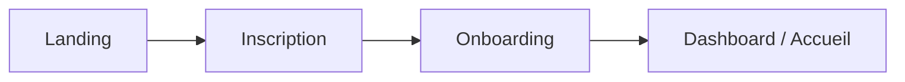
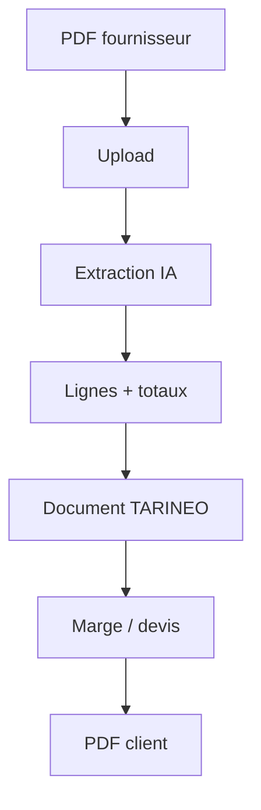
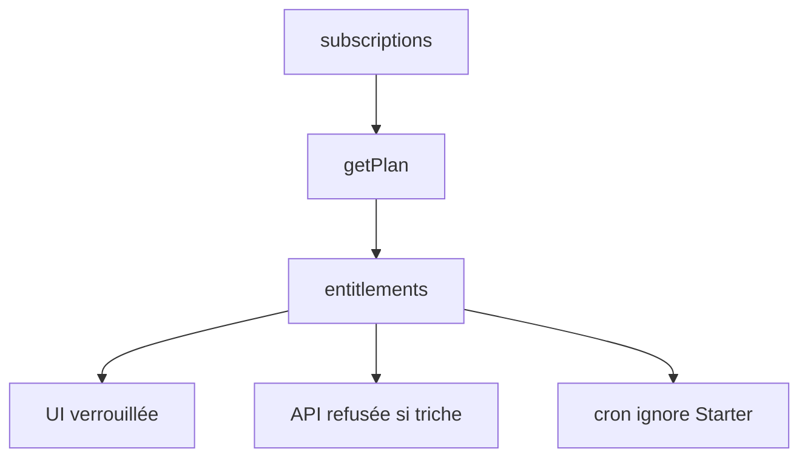
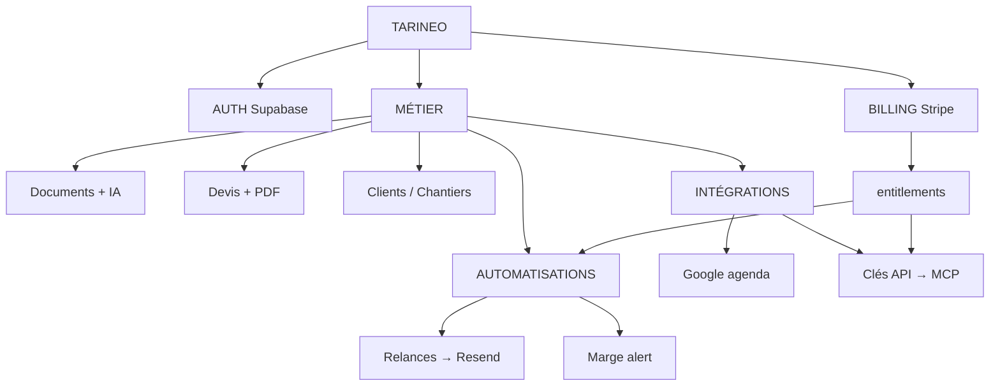

# TARINEO — Guide Starter / Pro (pour Noam)

Lis par blocs. Chaque section = une idée.

Docs liées :

- Carte produit : `docs/TARINEO-MISSION-CONTROL.md`
- Verrou technique : `docs/TARINEO-STARTER-PRO-ARCHITECTURE-LOCK.md`

---

## TARINEO en 60 secondes

1. L’artisan **importe** un PDF fournisseur.
2. L’**IA** lit les lignes et prix.
3. Il ajoute une **marge** et fait un **devis client**.
4. Il **envoie** le PDF (e-mail).
5. Il peut **relancer** le client (manuel ou auto en Pro).
6. **Stripe** dit s’il est Starter ou Pro.
7. **Supabase** stocke tout, avec **RLS** (chaque user ne voit que ses données).

---

## Comment un utilisateur arrive



- Auth : **Supabase** (e-mail, session cookie).
- Après login : pages sous `app/(app)/`.

---

## Comment un document fonctionne



Tables utiles : `documents` (+ `extract` JSON).

---

## Starter vs Pro — en une phrase

| Plan | Résumé |
|------|--------|
| **Starter** | Tout le métier + relances **à la main** + export compta **à la main**. |
| **Pro** | Starter + **automatisations** (relances auto, export auto) + **API/MCP** + agenda sync. |

**Qui décide ?**  
`subscriptions` (Stripe) → `getPlan()` → `lib/billing/entitlements.ts`.



---

## Exemple concret : relance automatique d’un devis

**Histoire :** Devis 2 400 € pour Jean Dupont. Relance auto activée (Pro). J+3 puis J+7.

### Étapes produit

| # | Quoi se passe |
|---|----------------|
| 1 | Devis créé / envoyé → `documents.extract.sent_at` |
| 2 | User Pro active **Planification auto** → `automation_definitions` slug `quote_followup` |
| 3 | Chaque jour, cron **`/api/cron/follow-ups`** |
| 4 | `autoScheduleDueQuoteFollowUps()` crée une ligne **`follow_ups`** (`status: scheduled`) |
| 5 | `processScheduledFollowUps()` envoie l’e-mail via **Resend** |
| 6 | Ligne passe à `sent` + log **`automation_executions`** |

### Fichiers / fonctions

| Rôle | Où |
|------|-----|
| Sauver réglages | `saveAutomationsAction` |
| Planifier auto | `autoScheduleDueQuoteFollowUps` |
| Envoyer | `processScheduledFollowUps` |
| Cron HTTP | `app/api/cron/follow-ups/route.ts` |
| E-mail | `sendDocumentMail` / Resend |

### Idempotence (pas de double envoi)

1. **Planification :** clé `schedule_key` + `tryInsertAutomationExecution` évite de recréer la même séquence.
2. **Envoi :** update optimiste sur `follow_ups` (`attempt_number`, `status = scheduled`, `sent_at` null) — si une autre instance a déjà claim, skip.

### Starter vs Pro sur ce flux

| | Starter | Pro |
|---|---------|-----|
| Relance depuis fiche devis | ✅ | ✅ |
| Cocher « planification auto » | ❌ UI + serveur | ✅ |
| Cron planifie pour lui | ❌ skip | ✅ |
| Cron envoie une relance **déjà programmée** (manuel) | ✅ | ✅ |

---

## Comment fonctionne une automation (vue simple)

```text
Réglage utilisateur (automatisations)
        ↓
automation_definitions (par user)
        ↓
Cron quotidien OU action immédiate
        ↓
follow_ups / notifications / exports
        ↓
automation_executions (journal)
```

**Marge sous seuil :** notification in-app (Starter **et** Pro). Pas d’e-mail auto branché aujourd’hui.

---

## Comment fonctionne un e-mail

- **Resend** envoie (relances, pièces jointes PDF, export CSV compta).
- Préférences : `notification-store` (peut skip si user a désactivé certains mails).

---

## Comment fonctionne Stripe

1. User va sur **Paramètres → Abonnement**.
2. Checkout Stripe → webhook `app/api/billing/webhook`.
3. `lib/billing/stripe-events.ts` met à jour **`subscriptions`**.
4. Au prochain chargement : `getPlan()` lit la ligne.

Pas de deuxième table de plans.

---

## Comment fonctionne Supabase

- **Auth** : utilisateurs.
- **DB** : documents, clients, relances, automations, abonnements.
- **Storage** : PDF / fichiers.
- **RLS** : `user_id = auth.uid()` sur les tables métier.

Les crons utilisent le **service role** (admin) mais filtrent toujours par `user_id`.

---

## Comment fonctionne l’IA

- Extraction document : agent métier (Anthropic) sur upload.
- Quotas : `limitReached(db, "ai")` selon plan (héritage Navpit).

---

## TARINEO ↔ n8n

```mermaid
flowchart LR
  N8N[n8n] -->|Bearer npk_…| ING[POST /api/integrations/ingest-document]
  ING --> KEY[API key + scope write]
  KEY --> PRO[entitlement mcp_business Pro]
  PRO --> IA[ingestDocumentWithAgent]
  IA --> DB[(documents Supabase)]
  DB --> JSON[Réponse structurée]
  MCP[/api/mcp tarineo_*] --> PRO
```

Docs : `docs/TARINEO-N8N-CONTRACT.md` (API) et `docs/TARINEO-N8N-GMAIL-WORKFLOW.md` (Gmail pas à pas).

### Premier scénario (email fournisseur)

| Étape | Statut |
|-------|--------|
| n8n + PDF manuel → ingest API | 🟢 |
| n8n + Gmail trigger | 🟡 (côté n8n, pas TARINEO) |
| Webhook sortant TARINEO → n8n | 🔴 |
| Devis client auto après ingest | 🔴 (manuel dans l’app) |

---

## Comment fonctionne MCP

- URL : `/api/mcp`
- Auth : **Bearer** = clé API (`api_keys`, hash en base)
- Scopes : `read` / `write`

### Table des tools (état actuel)

| Tool | Existant | Métier TARINEO | Starter | Pro | Action |
|------|:--------:|:--------------:|:-------:|:---:|--------|
| get_focus | ✅ | ❌ Navpit | ❌ | ✅ | Garder ; métier plus tard |
| list_projects | ✅ | ❌ | ❌ | ✅ | Idem |
| get_project | ✅ | ❌ | ❌ | ✅ | Idem |
| list_tasks | ✅ | ❌ | ❌ | ✅ | Idem |
| search_notes | ✅ | ❌ | ❌ | ✅ | Idem |
| create_project | ✅ | ❌ | ❌ | ✅ | Idem |
| create_task | ✅ | ❌ | ❌ | ✅ | Idem |
| update_task | ✅ | ❌ | ❌ | ✅ | Idem |
| add_note | ✅ | ❌ | ❌ | ✅ | Idem |
| list_landings | ✅ | ❌ | ❌ | ✅ | Idem |
| attach_landing | ✅ | ❌ | ❌ | ✅ | Idem |
| tarineo_list_documents | ✅ | ✅ métier | ❌ | ✅ | `mcp_business` |
| tarineo_get_document | ✅ | ✅ métier | ❌ | ✅ | `mcp_business` |
| tarineo_ingest_document | ✅ | ✅ métier | ❌ | ✅ | `mcp_business` + write |

---

## Ce qui est automatique vs manuel

| Action | Starter | Pro |
|--------|---------|-----|
| Créer devis / PDF | Manuel | Manuel |
| Relancer client | Manuel (programmer une date) | Manuel + **auto-planifié** |
| Export compta | Manuel (bouton) | Manuel + **planning e-mail** |
| Alerte marge | Auto notification app | Idem |

---

## Ce qui est encore impossible

- Ingérer un mail Gmail **depuis TARINEO** seul (n8n doit lire Gmail).
- MCP : **créer** un devis TARINEO (pas encore).
- Webhooks sortants vers n8n.
- Enterprise / multi-siège.

---

## Ce qui manque pour « vraie prod » billing

1. Tests E2E Stripe staging (Starter payé, Pro payé, downgrade).
2. Message clair si essai Pro expire → retombe sur Gratuit/Starter.
3. Tools API métier + doc OpenAPI pour n8n.
4. Monitoring cron (relances / exports) + alertes.

---

## Carte globale de l’app (réalité repo)



---

## Phrases à retenir

> **Starter** fait le métier au quotidien, à la main pour les relances planifiées et l’export compta.

> **Pro** ajoute le **cron** qui travaille pour lui + **API/MCP**.

> **n8n** passe par **clé API Pro** + `POST /api/integrations/ingest-document` — pas par `CRON_SECRET`.

> Si l’UI est verrouillée mais le serveur accepte encore, c’est un bug — le serveur gagne toujours.
