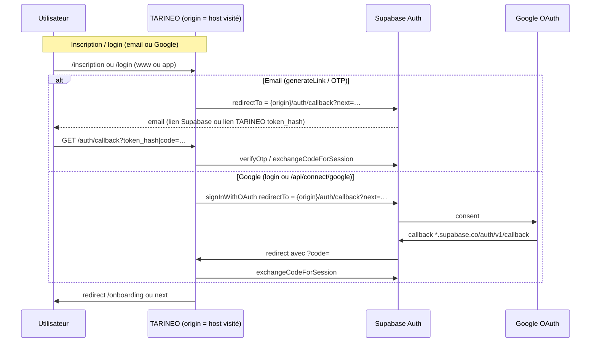

# TARINEO — Audit domaines & Auth (pré-production)

**Date :** 2026-10-06  
**Mode :** audit uniquement (aucune modification appliquée hors ce document).  
**Périmètre :** `tarineo.com`, `www.tarineo.com`, `app.tarineo.com`, Supabase Auth, OAuth Google, Vercel.

---

## 1. Architecture actuelle

| Couche | Comportement observé |
|--------|----------------------|
| **Hébergement** | Un seul projet Vercel **`tarineo-app`** expose les trois hôtes : `tarineo.com`, `www.tarineo.com`, `app.tarineo.com` (CLI `vercel domains inspect tarineo.com`, 2026-10-06). |
| **DNS / redirection** | `https://tarineo.com/*` répond **308** vers `https://www.tarineo.com/*` (curl `/login`, `/inscription`). |
| **Application** | Next.js App Router : marketing (`/`), auth (`/login`, `/inscription`), callback (`/auth/callback`), app métier (`/accueil`, …) sur **le même déploiement**. |
| **Auth** | Supabase Auth (session cookies SSR) + emails Resend (`lib/email/auth-mail.ts`) + OAuth Google via `signInWithOAuth` (pas de redirect Google Cloud direct vers TARINEO). |
| **Canonique code** | Fallback hardcodé `https://app.tarineo.com` (`lib/site-url.ts`) ; surcharge via `NEXT_PUBLIC_APP_URL`. |



---

## 2. Domaines détectés

### Dans le code (références `.com`)

| Domaine | Rôle dans le code |
|---------|-------------------|
| `https://app.tarineo.com` | Canonique fallback (`lib/site-url.ts`), emails (PreviewProps), Stripe webhook comment, assistant allowlist, docs `.env.example`. |
| `tarineo.com` / `*.tarineo.com` | `originFrom()` accepte l’hôte pour mails serveur (`lib/email/auth-mail.ts`) ; contact `contact@tarineo.com`. |
| `https://www.tarineo.com` | `lib/design-data/audit.ts`, seed data — pas de logique auth dédiée. |
| `https://www.tarineo.fr` | `BRAND.siteUrl` si pas de `NEXT_PUBLIC_APP_URL` en local (`lib/brand.ts`) ; middleware HTTPS. |

### Mesures HTTP (2026-10-06)

| URL | Statut |
|-----|--------|
| `https://tarineo.com/login` | **308** → `www.tarineo.com/login` |
| `https://www.tarineo.com/login` | **200** (HTML app) |
| `https://app.tarineo.com/login` | **200** (HTML app) |
| `https://www.tarineo.com/auth/callback` | **200** |
| `https://app.tarineo.com/auth/callback` | **200** |

*(Les anciens rapports mentionnant un 404 sur `app.tarineo.com/login` sont **obsolètes** par rapport à ces mesures.)*

### Vercel (vérifiable CLI)

| Élément | Valeur |
|---------|--------|
| Projet lié au repo | `tarineo-app` (`.vercel/project.json`) |
| Production URL affichée | `https://app.tarineo.com` (`vercel project ls`) |
| Domaines attachés au projet | `app.tarineo.com`, `www.tarineo.com`, `tarineo.com` |

---

## 3. URL canonique détectée

| Source | URL effective |
|--------|----------------|
| **`getSiteUrl()`** | 1) `NEXT_PUBLIC_APP_URL` (si non vide, pas localhost/navpit en prod) → 2) sinon `https://${VERCEL_URL}` → 3) sinon `https://app.tarineo.com` → 4) dev : `BRAND.siteUrl` (`https://www.tarineo.fr`). |
| **`.env.example`** | `NEXT_PUBLIC_APP_URL=https://app.tarineo.com` |
| **Vercel Production** | Variable `NEXT_PUBLIC_APP_URL` **présente** (liste chiffrée, `vercel env ls`). **Valeur exacte : NON VÉRIFIABLE** via CLI (`vercel env pull` → `NEXT_PUBLIC_APP_URL=""` dans le fichier généré ; probablement masquage / liaison locale, à confirmer dans le dashboard). |
| **Trafic marketing** | Utilisateurs souvent sur **`www.tarineo.com`** (apex redirigé). |
| **Landing CTAs** | Chemins relatifs `/inscription`, `/login` → **même host** que la page visitée. |

**Conclusion :** le code considère **`app.tarineo.com`** comme canonique produit ; le trafic public peut authentifier sur **`www.tarineo.com`** grâce à `window.location.origin` / `originFrom()`, si Supabase autorise ce host.

---

## 4. Flux inscription

1. Utilisateur : `/inscription` (souvent `www` après redirect apex).
2. **`sendSignupCode`** (`lib/email/auth-mail.ts`) :
   - `origin` = `x-forwarded-host` / `host` si hôte autorisé (`tarineo.com`, `*.tarineo.com`, `app.tarineo.com`, `*.vercel.app`, local).
   - `redirectTo` = `{origin}/auth/callback?next=…` passé à `admin.generateLink({ type: "signup", … })`.
   - Lien cliquable dans l’email : `{origin}/auth/callback?token_hash=…&type=…&next=…` (pas le domaine Supabase seul).
   - `appUrl` dans le template email : **`getSiteUrl()`** (souvent `app` si env = app).
3. Callback : `app/auth/callback/route.ts` → `verifyOtp` / `exchangeCodeForSession` → `settleAuthSession(supabase, **origin de la requête**, next)`.
4. Onboarding : `new URL("/onboarding", origin)` → reste sur le host du callback.

**Risque :** si Supabase **n’autorise pas** `https://www.tarineo.com/auth/callback` dans Redirect URLs, inscription / confirmation **échoue** pour les utilisateurs venant du site marketing.

---

## 5. Flux magic link / OTP

| Chemin | `redirectTo` / `emailRedirectTo` |
|--------|----------------------------------|
| Login code serveur | `sendLoginCode` → même pattern que signup (`origin` + `/auth/callback`). |
| Login OTP client (fallback) | `login-form.tsx` → `window.location.origin` + `/auth/callback`. |
| Mot de passe oublié | `forgot-form.tsx` → `window.location.origin` + `/auth/callback?next=/nouveau-mot-de-passe`. |
| Recovery serveur | `sendRecoveryCode` → `origin` + callback. |

Fallback Supabase natif (OTP) si Resend indisponible : le lien Supabase doit aussi respecter la **allowlist Redirect URLs** du projet cloud.

---

## 6. Flux Google OAuth

| Entrée | Fichier | `redirectTo` |
|--------|---------|--------------|
| Bouton Google login/inscription | `components/auth/auth-ui.tsx` | `${window.location.origin}/auth/callback?next=…` |
| Connexion Gmail/Drive (intégrations) | `app/api/connect/google/route.ts` | `${url.origin}/auth/callback?next=…` (scopes Gmail/Drive) |

**Chaîne attendue (OK dans le code) :**

`Google` → `https://<project>.supabase.co/auth/v1/callback` → `TARINEO /auth/callback?code=…` → destination `next`.

**Aucun code** n’enregistre `https://tarineo.com/auth/callback` comme **Authorized redirect URI** côté Google Cloud : c’est **correct** tant que Google pointe uniquement vers Supabase.

**Google Cloud / Supabase Dashboard :** configuration réelle **NON VÉRIFIABLE** depuis le repo (pas de secrets ni d’export dashboard).

---

## 7. Variables d’environnement concernées

| Variable | Usage auth / domaines |
|----------|------------------------|
| `NEXT_PUBLIC_APP_URL` | Canonique `getSiteUrl()` : metadata, emails secondaires, Stripe return URLs en prod, allowlist assistant (si parsable). |
| `NEXT_PUBLIC_SUPABASE_URL` | Client Supabase. |
| `NEXT_PUBLIC_SUPABASE_ANON_KEY` | Client Supabase. |
| `SUPABASE_SERVICE_ROLE_KEY` | `generateLink`, admin users (`auth-mail.ts`). |
| `EMAIL_FROM` | Expéditeur mails auth. |
| `VERCEL_URL` | Fallback de `getSiteUrl()` si `NEXT_PUBLIC_APP_URL` absent. |

Pas de variable `SITE_URL` dans le code applicatif.

### Supabase local (`supabase/config.toml`) — **dev uniquement, pas la prod cloud**

- `site_url = "http://127.0.0.1:3000"`
- `additional_redirect_urls` : localhost, `https://*.vercel.app/**`, `https://app.tarineo.com`, `https://app.tarineo.com/**`
- **Pas** de `www.tarineo.com` ni `tarineo.com` dans le fichier local.

### Supabase cloud (dashboard)

**NON VÉRIFIABLE** par API/outil Supabase dans ce repo.

Indication indirecte (capture dashboard session précédente, à revalider manuellement) :

- Site URL en cours d’édition : `https://tarineo.com`
- Redirect URLs listées : `https://app.tarineo.com/**`, `https://app.tarineo.com/auth/callback`, `http://localhost:3000/**`
- **Absence probable de `https://www.tarineo.com/**`** alors que Vercel redirige l’apex vers `www`.

---

## 8. Incohérences

| # | Sujet | Détail |
|---|--------|--------|
| I1 | **www vs app vs apex** | Trafic marketing → `www` ; canonique code/docs → `app` ; apex → `www`. Trois hôtes, un déploiement. |
| I2 | **Supabase Redirect URLs vs hosts réels** | Flux utilisent `{origin}/auth/callback` = souvent **`www.tarineo.com`** ; allowlist documentée / screenshot centrée sur **`app`**. |
| I3 | **Site URL Supabase vs Vercel redirect** | Site URL `tarineo.com` alors que `/login` public passe par **`www`** (308). |
| I4 | **`NEXT_PUBLIC_APP_URL`** | Documenté = `app` ; valeur prod exacte non lue ; si vide → `getSiteUrl()` peut utiliser `VERCEL_URL` (*.vercel.app), pas le domaine custom. |
| I5 | **Assistant / API** | `lib/assistant/origin.ts` : allowlist inclut `https://app.tarineo.com` + origine de `NEXT_PUBLIC_APP_URL` — **pas** `www` sauf si env = www. |
| I6 | **`continueAfterAuth`** | Utilise `getSiteUrl()` pour `settleAuthSession`, pas `window.location.origin` — onboarding depuis saisie code sur `www` peut cibler **`app`** si env = app. |
| I7 | **Docs internes** | `docs/tarineo-manual-config.md` / `tarineo-final-qa.md` : 404 `app/login`, `www.tarineo.fr` — partiellement dépassés vs HTTP 2026-10-06. |
| I8 | **README / MARKETING-GO-LIVE** | Encore des références `navpit.com` pour `NEXT_PUBLIC_APP_URL`. |
| I9 | **Emails PreviewProps** | Templates React : exemples hardcodés `https://app.tarineo.com` (runtime prod utilise `getSiteUrl()` dans `auth-mail.ts`). |

---

## 9. Classification P0 / P1 / P2 / OK

| ID | Niveau | Problème |
|----|--------|----------|
| R1 | **P0** | **Redirect URLs Supabase** : si `https://www.tarineo.com/**` (et idéalement `https://tarineo.com/**`) ne sont pas dans l’allowlist, **inscription, magic link et Google depuis www échouent** (`redirect_to not allowed`). *À confirmer dans le dashboard Supabase (NON VÉRIFIABLE ici).* |
| R2 | **P1** | **`NEXT_PUBLIC_APP_URL`** : valeur production non confirmée ; si vide ou incohérente → metadata, liens secondaires emails, Stripe, onboarding via `continueAfterAuth` sur le mauvais host. |
| R3 | **P1** | **Double host www + app** : cookies de session **par host** ; utilisateur peut se connecter sur `www` et sembler déconnecté sur `app` (ou l’inverse) sans redirection unifiée. |
| R4 | **P1** | **Copilot / `/api/assistant`** depuis `www.tarineo.com` si `NEXT_PUBLIC_APP_URL=https://app.tarineo.com` → origine refusée (`lib/assistant/origin.ts`). |
| R5 | **P2** | Middleware HTTPS : force redirect HTTP→HTTPS pour `app.tarineo.com`, pas explicitement pour `www.tarineo.com` / `tarineo.com` (Vercel gère déjà en pratique). |
| R6 | **P2** | `supabase/config.toml` local sans www — impact dev/staging CLI seulement. |
| R7 | **P2** | Documentation ops obsolète (404 login, domaines). |
| O1 | **OK** | Pas de redirect Google Cloud direct vers `tarineo.com/auth/callback` dans le code. |
| O2 | **OK** | `auth-mail.ts` autorise explicitement les hôtes `*.tarineo.com`. |
| O3 | **OK** | Vercel : les trois domaines sont sur **`tarineo-app`** ; `/login` et `/auth/callback` répondent 200 sur www et app. |
| O4 | **OK** | Route `/auth/callback` gère `code`, `token_hash`, PKCE, fragment legacy. |

---

## 10. Corrections recommandées (hors scope audit — à faire manuellement)

1. **Supabase → Authentication → URL Configuration**  
   - Ajouter : `https://www.tarineo.com/**`, `https://www.tarineo.com/auth/callback`.  
   - Conserver : `https://app.tarineo.com/**`, `http://localhost:3000/**`, previews `https://*.vercel.app/**` si utilisés.  
   - Optionnel apex : `https://tarineo.com/**` (peu utilisé après 308, mais safe).  
   - **Site URL** : choisir une référence unique (`https://www.tarineo.com` *ou* `https://app.tarineo.com`) alignée avec la stratégie produit ; documenter le choix.

2. **Vercel → Environment Variables (Production)**  
   - Vérifier que `NEXT_PUBLIC_APP_URL` = URL canonique voulue (souvent `https://app.tarineo.com` **ou** `https://www.tarineo.com`, pas vide).  
   - Redéployer après changement.

3. **Stratégie produit (une seule “maison” auth)**  
   - Soit rediriger systématiquement `www` → `app` pour `/login` `/inscription` (config Vercel / middleware),  
   - Soit assumer **www** comme entrée et aligner canonique + emails + Supabase sur **www**.

4. **Tests manuels avant prod** (checklist)  
   - Inscription sur `https://www.tarineo.com/inscription` → email → callback.  
   - Même test sur `https://app.tarineo.com/inscription`.  
   - Google login sur www et app.  
   - Gmail bind : `/api/connect/google` depuis `/automatisations` sur le host utilisé en prod.

5. **Google Cloud Console**  
   - Vérifier que l’URI autorisée reste `https://<ref>.supabase.co/auth/v1/callback` uniquement.

6. **Code (PR future, pas dans cet audit)**  
   - Harmoniser `continueAfterAuth` / assistant allowlist avec les hosts réels si www reste l’entrée marketing.

---

## Méthodologie

- Analyse statique du dépôt TARINEO (`grep`, lecture routes auth, `lib/site-url.ts`, `lib/email/auth-mail.ts`, middleware).  
- Vercel CLI : domaines, projet `tarineo-app`, liste des variables (valeurs chiffrées).  
- HTTP : `curl -I` sur login et callback.  
- Supabase cloud : **pas d’accès API/dashboard** dans cet audit ; `config.toml` = local uniquement.

---

## Résumé exécutif

```
AUTH DOMAIN AUDIT: NEEDS FIX
```

**Blocages potentiels avant tests prod :**

1. **Allowlist Supabase** : confirmer **`https://www.tarineo.com/**`** (requis si inscription/login sur www — comportement actuel Vercel).  
2. **`NEXT_PUBLIC_APP_URL`** : confirmer la valeur en Production Vercel (non vide, alignée avec la canonique choisie).  
3. **Sessions multi-host** : valider le parcours utilisateur www ↔ app (cookies) selon la stratégie retenue.
